<!--

# [sett.sarverott.com](https://sett.sarverott.com/) :: HELLO WORLD!

I like technology, reading about its details and observing its vulnerabilities. 
I program by vocation, the open source mission inspired me to publish my work. 
I do not limit myself to specific environment and language. 
Over the years, programming has become my form of self-expression. 
I hope that you find my work usefull and worth noticing.

---

### Some statistical data 

> Extension of statistic summary

---
| ![`<<< statistics of used languages >>>`][use-of-languages-statistics] | ![`<<< statistics display >>>`][main-raport-stats] |
| :--- | :--- |
| ![`<<< GitHub Streak >>>`][combo-stats] | ![`<<< TryHackMe profile >>>`][tryhackme] |

---
  
### Links to my actions  
> Shordcuts to my work across the internet

---

| developer platforms | socialmedia 
| :--- | :--- |
| [![NPM][npm-button]][npm-link] [![DOCKER][docker-button]][docker-link] [![PY-PI][pip-button]][pip-link] [![Packagist][composer-button]][composer-link] | [![FB][facebook-button]][facebook-link] [![INSTAGRAM][instagram-button]][instagram-link][![TWITTER][twitter-button]][twitter-link] [![BLOGSPOT][blogspot-button]][blogspot-link] [![TUMBLR][tumblr-button]][tumblr-link] |

---

### More about
| Contact ways | github supervision site | personal entry www |
| --- | --- | --- |
| EMAIL: __sett@sarverott.com__ | GITHUB SITE: https://sarverott.github.io/ | WWW: https://sarverott.com/ |

-->

# USER: [`Sett Sarverott A.A.B.`](https://orcid.org/0009-0006-4604-6540) [`<sett@sarverott.com>`](mailto:sett@sarverott.com)

> NOTE: right now _(UNIXUSAT=1791779668372)_ i'm working on refreshing own presence and portfolio viewability. soon this text should be replaced. for now in case of need to contact me [just send me mail](mailto:sett@sarverott.com), if it will reach me it receive response. I usually provide a response no later than a week after receiving it.

---

- github:
- tumblr:
- x: https://x.com/sarverott
- instagram: https://www.instagram.com/sarverott/
- pypi: https://pypi.org/user/sarverott/
- docker hub: https://hub.docker.com/u/sarverott
- npm: 

---

### display of [gitrecon][gitrecon_link] scan

```mermaid
---
title: Network of my presence on GitHub
---

flowchart LR
  org_apokaliptium["apokaliptium<br/>15 repos · 8 forks · ★0"]:::org
  org_bonescraft["bonescraft<br/>0 repos · 0 forks · ★0"]:::org
  org_cyber_nomad_collective["Cyber-Nomad-Collective<br/>47 repos · 2 forks · ★2"]:::org
  org_project_anubis["project-anubis<br/>22 repos · 18 forks · ★1"]:::org
  org_radio_cat_music["radio-cat-music<br/>7 repos · 1 forks · ★0"]:::org
  org_radiokociamuzyka["radiokociamuzyka<br/>12 repos · 2 forks · ★0"]:::org
  org_rattish["rattish<br/>10 repos · 5 forks · ★0"]:::org
  org_redscope_pl["redscope-pl<br/>46 repos · 31 forks · ★0"]:::org
  org_silesiamakerspace["SilesiaMakerSpace<br/>6 repos · 2 forks · ★0"]:::org
  org_the_apokryf["The-Apokryf<br/>121 repos · 98 forks · ★0"]:::org
  org_the_house_of_anubis["the-House-of-Anubis<br/>16 repos · 3 forks · ★0"]:::org
  user_sarverott(["Sarverott<br/>158 repos · 43 forks · ★17"]):::user
  org_actions("actions"):::outside
  org_arduino("arduino"):::outside
  org_arweaveteam("ArweaveTeam"):::outside
  org_atom("atom"):::outside
  org_autotools_mirror("autotools-mirror"):::outside
  org_badges("badges"):::outside
  org_cosmos("cosmos"):::outside
  org_deepseek_ai("deepseek-ai"):::outside
  org_dethcrypto("dethcrypto"):::outside
  org_discord("discord"):::outside
  org_dolibarr("Dolibarr"):::outside
  org_github("github"):::outside
  org_go_gitea("go-gitea"):::outside
  org_go_task("go-task"):::outside
  org_google("google"):::outside
  org_gravitational("gravitational"):::outside
  org_hyperweb_io("hyperweb-io"):::outside
  org_ipfs("ipfs"):::outside
  org_ipicoin("ipicoin"):::outside
  org_localtunnel("localtunnel"):::outside
  org_matrix_org("matrix-org"):::outside
  org_microsoft("microsoft"):::outside
  org_multiversx("multiversx"):::outside
  org_nervosnetwork("nervosnetwork"):::outside
  org_node_red("node-red"):::outside
  org_odoo("odoo"):::outside
  org_ollama("ollama"):::outside
  org_open_webui("open-webui"):::outside
  org_openmaptiles("openmaptiles"):::outside
  org_orbitjs("orbitjs"):::outside
  org_seeed_studio("Seeed-Studio"):::outside
  org_snort3("snort3"):::outside
  org_yubico("Yubico"):::outside
  user_aaronfeng753("AaronFeng753"):::outside
  user_apocas("apocas"):::outside
  user_ggerganov("ggerganov"):::outside
  user_jaimecheng("JaimeCheng"):::outside
  user_jgthms("jgthms"):::outside
  user_jiangts("jiangts"):::outside
  user_kaichaosun("kaichaosun"):::outside
  user_lawl("lawl"):::outside
  user_lilalio("LilaLio"):::outside
  user_milio48("milio48"):::outside
  user_mudcube("mudcube"):::outside
  user_paulredmond("paulredmond"):::outside
  user_pmikstacki("pmikstacki"):::outside
  user_qiao("qiao"):::outside
  user_remy("remy"):::outside
  user_sarverott -->|member| org_apokaliptium
  user_sarverott -->|member| org_bonescraft
  user_sarverott -->|member| org_cyber_nomad_collective
  user_sarverott -->|member| org_project_anubis
  user_sarverott -->|member| org_radio_cat_music
  user_sarverott -->|member| org_radiokociamuzyka
  user_sarverott -->|member| org_rattish
  user_sarverott -->|member| org_redscope_pl
  user_sarverott -->|member| org_silesiamakerspace
  user_sarverott -->|member| org_the_apokryf
  user_sarverott -->|member| org_the_house_of_anubis
  org_project_anubis ==>|"8 forks"| org_atom
  org_project_anubis ==>|"7 forks"| user_sarverott
  user_sarverott ==>|"6 forks"| org_the_apokryf
  org_redscope_pl ==>|"6 forks"| user_sarverott
  user_sarverott -.->|"4 forks"| org_ipicoin
  org_rattish -.->|"4 forks"| user_sarverott
  user_sarverott -.->|"3 forks"| org_rattish
  user_sarverott -.->|"3 forks"| org_actions
  user_sarverott -.->|"3 forks"| org_redscope_pl
  org_redscope_pl -.->|"3 forks"| org_matrix_org
  org_redscope_pl -.->|"3 forks"| org_localtunnel
  user_sarverott -.->|"2 forks"| org_discord
  user_sarverott -.->|"2 forks"| org_github
  user_sarverott -.->|"2 forks"| org_the_house_of_anubis
  org_redscope_pl -.->|"2 forks"| org_arduino
  org_silesiamakerspace -.->|"2 forks"| user_sarverott
  org_apokaliptium -.->|"2 forks"| org_nervosnetwork
  user_sarverott -.->|"1 fork"| org_openmaptiles
  user_sarverott -.->|"1 fork"| user_lilalio
  user_sarverott -.->|"1 fork"| org_seeed_studio
  user_sarverott -.->|"1 fork"| org_atom
  user_sarverott -.->|"1 fork"| user_jaimecheng
  user_sarverott -.->|"1 fork"| user_remy
  user_sarverott -.->|"1 fork"| org_autotools_mirror
  user_sarverott -.->|"1 fork"| user_jgthms
  user_sarverott -.->|"1 fork"| org_dolibarr
  user_sarverott -.->|"1 fork"| org_node_red
  user_sarverott -.->|"1 fork"| user_ggerganov
  user_sarverott -.->|"1 fork"| org_deepseek_ai
  user_sarverott -.->|"1 fork"| org_google
  user_sarverott -.->|"1 fork"| user_apocas
  user_sarverott -.->|"1 fork"| user_jiangts
  user_sarverott -.->|"1 fork"| user_lawl
  user_sarverott -.->|"1 fork"| user_mudcube
  user_sarverott -.->|"1 fork"| user_qiao
  org_project_anubis -.->|"1 fork"| user_paulredmond
  org_project_anubis -.->|"1 fork"| user_remy
  org_project_anubis -.->|"1 fork"| org_snort3
  org_rattish -.->|"1 fork"| user_remy
  org_the_house_of_anubis -.->|"1 fork"| user_aaronfeng753
  org_the_house_of_anubis -.->|"1 fork"| org_the_apokryf
  org_the_house_of_anubis -.->|"1 fork"| org_microsoft
  org_radio_cat_music -.->|"1 fork"| user_remy
  org_radiokociamuzyka -.->|"1 fork"| user_remy
  org_radiokociamuzyka -.->|"1 fork"| user_sarverott
  org_redscope_pl -.->|"1 fork"| org_arweaveteam
  org_redscope_pl -.->|"1 fork"| org_ipfs
  org_redscope_pl -.->|"1 fork"| org_go_task
  org_redscope_pl -.->|"1 fork"| org_ollama
  org_redscope_pl -.->|"1 fork"| org_open_webui
  org_redscope_pl -.->|"1 fork"| org_github
  org_redscope_pl -.->|"1 fork"| org_actions
  org_redscope_pl -.->|"1 fork"| org_atom
  org_redscope_pl -.->|"1 fork"| org_odoo
  org_redscope_pl -.->|"1 fork"| org_yubico
  org_redscope_pl -.->|"1 fork"| user_kaichaosun
  org_redscope_pl -.->|"1 fork"| user_milio48
  org_redscope_pl -.->|"1 fork"| org_gravitational
  org_redscope_pl -.->|"1 fork"| org_orbitjs
  org_redscope_pl -.->|"1 fork"| org_the_apokryf
  org_redscope_pl -.->|"1 fork"| org_radiokociamuzyka
  org_redscope_pl -.->|"1 fork"| org_badges
  org_cyber_nomad_collective -.->|"1 fork"| user_pmikstacki
  org_cyber_nomad_collective -.->|"1 fork"| user_remy
  org_apokaliptium -.->|"1 fork"| user_sarverott
  org_apokaliptium -.->|"1 fork"| org_cosmos
  org_apokaliptium -.->|"1 fork"| org_hyperweb_io
  org_apokaliptium -.->|"1 fork"| org_go_gitea
  org_apokaliptium -.->|"1 fork"| org_multiversx
  org_apokaliptium -.->|"1 fork"| org_dethcrypto
  click org_actions "https://github.com/actions"
  click org_apokaliptium "https://github.com/apokaliptium"
  click org_arduino "https://github.com/arduino"
  click org_arweaveteam "https://github.com/arweaveteam"
  click org_atom "https://github.com/atom"
  click org_autotools_mirror "https://github.com/autotools-mirror"
  click org_badges "https://github.com/badges"
  click org_bonescraft "https://github.com/bonescraft"
  click org_cosmos "https://github.com/cosmos"
  click org_cyber_nomad_collective "https://github.com/cyber-nomad-collective"
  click org_deepseek_ai "https://github.com/deepseek-ai"
  click org_dethcrypto "https://github.com/dethcrypto"
  click org_discord "https://github.com/discord"
  click org_dolibarr "https://github.com/dolibarr"
  click org_github "https://github.com/github"
  click org_go_gitea "https://github.com/go-gitea"
  click org_go_task "https://github.com/go-task"
  click org_google "https://github.com/google"
  click org_gravitational "https://github.com/gravitational"
  click org_hyperweb_io "https://github.com/hyperweb-io"
  click org_ipfs "https://github.com/ipfs"
  click org_ipicoin "https://github.com/ipicoin"
  click org_localtunnel "https://github.com/localtunnel"
  click org_matrix_org "https://github.com/matrix-org"
  click org_microsoft "https://github.com/microsoft"
  click org_multiversx "https://github.com/multiversx"
  click org_nervosnetwork "https://github.com/nervosnetwork"
  click org_node_red "https://github.com/node-red"
  click org_odoo "https://github.com/odoo"
  click org_ollama "https://github.com/ollama"
  click org_open_webui "https://github.com/open-webui"
  click org_openmaptiles "https://github.com/openmaptiles"
  click org_orbitjs "https://github.com/orbitjs"
  click org_project_anubis "https://github.com/project-anubis"
  click org_radio_cat_music "https://github.com/radio-cat-music"
  click org_radiokociamuzyka "https://github.com/radiokociamuzyka"
  click org_rattish "https://github.com/rattish"
  click org_redscope_pl "https://github.com/redscope-pl"
  click org_seeed_studio "https://github.com/seeed-studio"
  click org_silesiamakerspace "https://github.com/silesiamakerspace"
  click org_snort3 "https://github.com/snort3"
  click org_the_apokryf "https://github.com/the-apokryf"
  click org_the_house_of_anubis "https://github.com/the-house-of-anubis"
  click org_yubico "https://github.com/yubico"
  click user_aaronfeng753 "https://github.com/aaronfeng753"
  click user_apocas "https://github.com/apocas"
  click user_ggerganov "https://github.com/ggerganov"
  click user_jaimecheng "https://github.com/jaimecheng"
  click user_jgthms "https://github.com/jgthms"
  click user_jiangts "https://github.com/jiangts"
  click user_kaichaosun "https://github.com/kaichaosun"
  click user_lawl "https://github.com/lawl"
  click user_lilalio "https://github.com/lilalio"
  click user_milio48 "https://github.com/milio48"
  click user_mudcube "https://github.com/mudcube"
  click user_paulredmond "https://github.com/paulredmond"
  click user_pmikstacki "https://github.com/pmikstacki"
  click user_qiao "https://github.com/qiao"
  click user_remy "https://github.com/remy"
  click user_sarverott "https://github.com/sarverott"
classDef user fill:#dbeafe,stroke:#2563eb,stroke-width:1.5px,color:#172554
classDef org fill:#fef3c7,stroke:#d97706,stroke-width:1.5px,color:#78350f
classDef outside fill:#f8fafc,stroke:#64748b,stroke-width:1px,color:#0f172a,stroke-dasharray:4 3
classDef repo fill:#ecfdf5,stroke:#059669,stroke-width:1px,color:#064e3b
classDef fork fill:#f8fafc,stroke:#94a3b8,stroke-width:1px,color:#334155
```

[gitrecon_link]: https://github.com/Sarverott/gitrecon
<!--
[reddit-button]: https://img.shields.io/badge/Reddit-%23FF4500.svg?style=for-the-badge&logo=Reddit&logoColor=white
[reddit-link]: https://www.reddit.com/user/sarverott/
[facebook-button]: https://img.shields.io/badge/Facebook-1877F2.svg?style=for-the-badge&logo=Facebook&logoColor=white
[facebook-link]: https://www.facebook.com/sarverott
[instagram-button]: https://img.shields.io/badge/Instagram-E4405F.svg?style=for-the-badge&logo=Instagram&logoColor=white
[instagram-link]: https://www.instagram.com/sarverott/
[twitter-button]: https://img.shields.io/badge/Twitter-0D80D8.svg?style=for-the-badge&logo=X&logoColor=white
[twitter-link]: https://x.com/sarverott
[tumblr-button]: https://img.shields.io/badge/Tumblr-36465D.svg?style=for-the-badge&logo=Tumblr&logoColor=white
[tumblr-link]: https://sarverott.tumblr.com/
[blogspot-button]: https://img.shields.io/badge/Blogspot-FF5722.svg?style=for-the-badge&logo=Blogger&logoColor=white
[blogspot-link]:https://sarverott.blogspot.com/
[npm-button]: https://badgen.net/badge/icon/sarverott?icon=npm&color=red&label=NPM%20packages&labelColor=black
[npm-link]: https://www.npmjs.com/~sarverott
[docker-button]: https://badgen.net/badge/icon/sarverott?icon=docker&color=red&label=Docker%20containers&labelColor=black
[docker-link]: https://hub.docker.com/u/sarverott
[pip-button]: https://badgen.net/badge/icon/sarverott?icon=pypi&color=red&label=PyPi%20packages&labelColor=black
[pip-link]: https://pypi.org/user/sarverott/
[composer-button]: https://badgen.net/badge/icon/sarverott?icon=php&color=red&label=Composer%20packages&labelColor=black
[composer-link]: https://packagist.org/users/Sarverott/
[tryhackme]:  https://tryhackme-badges.s3.amazonaws.com/sarverott.png
[combo-stats]: https://streak-stats.demolab.com?user=sarverott&theme=shadow-red&text_color=888888
[main-raport-stats]: https://github-readme-stats.vercel.app/api?username=sarverott&show_icons=true&rank_icon=github&theme=shadow_red&include_all_commits=true
[use-of-languages-statistics]: https://github-readme-stats.vercel.app/api/top-langs/?username=sarverott&langs_count=8&theme=shadow_red&layout=compact&text_color=888888
-->